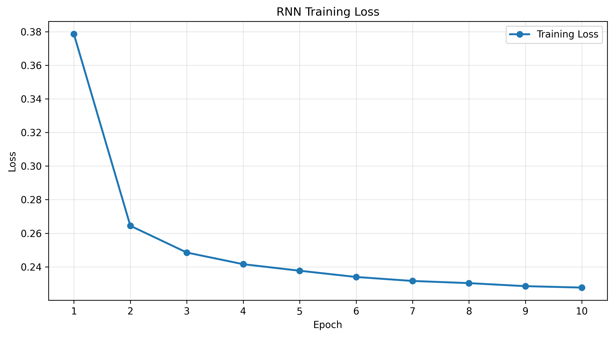
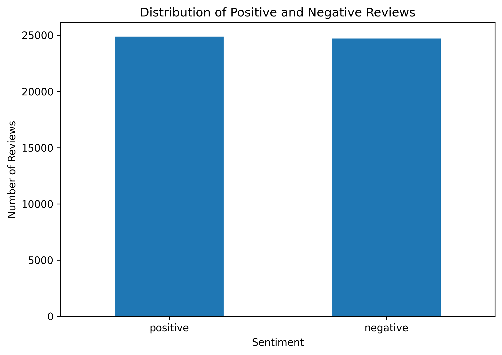
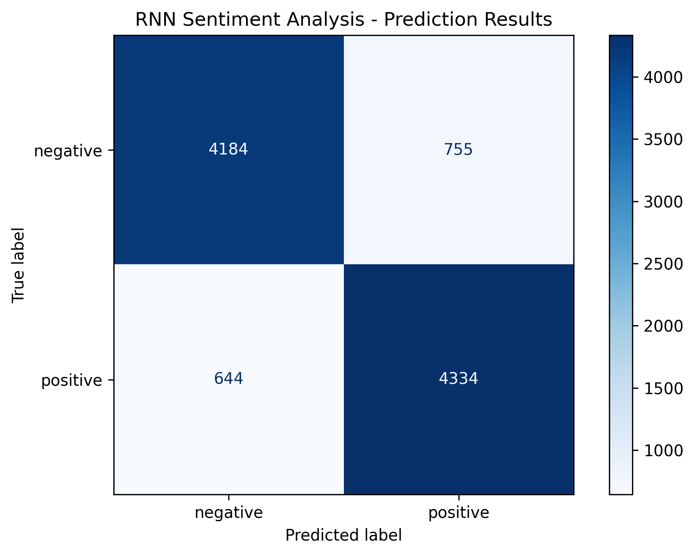

# IMDB Movie Review Sentiment Analysis using RNN

A Deep Learning project that classifies IMDB movie reviews as **Positive** or **Negative** using a Recurrent Neural Network (RNN) implemented with PyTorch.


## Project Overview

This project applies Natural Language Processing (NLP) and Deep Learning techniques to perform sentiment analysis on movie reviews.

The IMDB Movie Reviews dataset is used to train a PyTorch-based Recurrent Neural Network that predicts whether a given movie review expresses positive or negative sentiment.

The workflow includes text preprocessing, TF-IDF feature extraction, model training, and sentiment prediction.

## Dataset

- **Dataset:** IMDB Movie Reviews Dataset
- **Total Reviews:** 50,000
- **Target Classes:** Positive and Negative
- **Task:** Binary Sentiment Classification

## Technologies & Libraries

- Python
- PyTorch
- Pandas
- NumPy
- Scikit-learn
- NLTK
- Matplotlib
- Jupyter Notebook

## Project Workflow

1. **Data Loading:** Load the IMDB Movie Reviews dataset.
2. **Data Cleaning:** Remove duplicate reviews.
3. **Text Preprocessing:** Convert text to lowercase, remove URLs, HTML tags, punctuation, and stopwords, and apply stemming.
4. **Label Encoding:** Convert sentiment labels into numerical representations.
5. **TF-IDF Vectorization:** Extract 5,000 numerical features from the reviews.
6. **Train-Test Split:** Divide the dataset into 80% training and 20% testing data.
7. **Model Building:** Implement a Recurrent Neural Network using PyTorch.
8. **Model Training:** Train the RNN using the Adam optimizer and Binary Cross Entropy loss.
9. **Sentiment Prediction:** Classify movie reviews into positive or negative categories.

## Model Configuration

| Component | Configuration |
|---|---|
| Model | Recurrent Neural Network (RNN) |
| Framework | PyTorch |
| Input Features | 5,000 |
| Hidden Size | 128 |
| Number of RNN Layers | 1 |
| Fully Connected Layer | Linear(128, 1) |
| Loss Function | BCELoss |
| Optimizer | Adam |
| Batch Size | 64 |

## Results & Visualizations

### 1. Training Loss

Training loss visualization showing how the model's loss changes across training epochs.



### 2. Sentiment Distribution

Visualization of positive and negative movie reviews in the dataset.



### 3. Prediction Results

Confusion matrix showing the comparison between actual and predicted sentiment labels.



## Project Structure

```text
RNN/
│
├── notebook/
│   └── RNN.ipynb
│
├── results/
│   ├── prediction_results.png
│   ├── sentiment_distribution.png
│   └── training_loss.png
│
├── .gitignore
├── README.md
└── requirements.txt
```

## Installation & Setup

### 1. Clone the Repository

```bash
git clone YOUR_GITHUB_REPOSITORY_URL
```

```bash
cd RNN
```

### 2. Install Dependencies

```bash
pip install -r requirements.txt
```

### 3. Download the Dataset

Download the IMDB Movie Reviews dataset and place `IMDB Dataset.csv` in the repository's root directory.

### 4. Run the Notebook

```bash
jupyter notebook
```

Open:

```text
notebook/RNN.ipynb
```

Execute the notebook cells sequentially to reproduce the preprocessing, training, and evaluation workflow.

## Future Improvements

- Experiment with LSTM and GRU architectures.
- Explore word embeddings for better text representation.
- Compare different deep learning architectures.
- Improve classification performance through hyperparameter tuning.
- Deploy the trained sentiment analysis model using FastAPI or Streamlit.

## Author

**Uttam SB**

Aspiring AI/ML Engineer interested in Deep Learning, NLP, Computer Vision, and Generative AI.

---

If you find this project useful, consider giving it a ⭐ on GitHub!